# KobitoKey_QWERTY (DYA Studio / ZMK v0.4 系)

[juichi50iii/KobitoKey_QWERTY](https://github.com/juichi50iii/KobitoKey_QWERTY) のフォーク。
ハードの記述は公式のまま、ファームの構成を moNa2
([Daytona0306/zmk-config-moNa2-v2](https://github.com/Daytona0306/zmk-config-moNa2-v2)) と同じものに載せ替えている。

| | 公式 | このフォーク |
|---|---|---|
| ZMK | zmkfirmware v0.3 (Zephyr 3.5) | Daytona0306/zmk (v0.4 系, Zephyr 4.1) |
| PMW3610 ドライバ | badjeff 版 | cormoran 版 (DYA Studio のセンサータブ対応) |
| 回転・倍率 | sensor_rotation + scaler (固定) | runtime input processor (Studio で調整可) |
| central | 左 | 左 (変更なし) |

- 左ボール = 常時スクロール (スナップ + 慣性)、右ボール = カーソル + ジェスチャー。
  公式のオートマウスレイヤーは外した
- キー配列は torabo-tsuki LP
  ([Daytona0306/zmk-keyboard-torabo-tsuki-lp](https://github.com/Daytona0306/zmk-keyboard-torabo-tsuki-lp))
  の移植。13 レイヤーでレイヤー番号も同じ (下の「配列」を参照)
- ジェスチャー定義は `zmk-dya-common` と共有。hold-tap の実行時調整も入っている
- モジュールの SHA 固定は `tools/west-pins.py` (使い方は moNa2 の README)

実機で両ボールが動くことを確認済み (キーマップの細部は確認中)。

## キーマップ

全 13 レイヤーとコンボの図。`config/KobitoKey.keymap` を push すると GitHub Actions
(`.github/workflows/draw.yml`) が作り直して、同じブランチへ自動でコミットする。

## 焼く手順

ファームは GitHub Actions の成果物 (`kobitokey_left` / `kobitokey_right` / `kobitokey_reset`) を使う。

1. **公式ファームで動作確認する。** まず公式 (ZMK v0.3) のファームを左右に焼き、全キーと両ボールが動くことを見る。
   ハードの不良とこのファームの不具合を切り分けるため
2. **設定リセット用ファーム (`kobitokey_reset`) を左右それぞれに焼く。**
   公式は ZMK v0.3、この移植版は v0.4 系で、Flash に保存される設定 (ペアリング情報など) に互換性がない。
   消さずに焼くと起動しない・左右がつながらないなどの原因になる
3. **移植版を焼く。** 左に `kobitokey_left`、右に `kobitokey_right`。
   左右のペアリングをやり直し、ホストとも Bluetooth でペアリングし直す

## 実機が届いたら確認すること

- [ ] 全キーが左右とも効く (キーマップ図と見比べる)
- [ ] 右ボールのカーソルの向き (上下・左右)
- [ ] 左ボールのスクロールの向き (上下・左右)
- [ ] ジェスチャー (レイヤー 7〜12) の上下左右。
      逆なら `config/KobitoKey.keymap` の `DYA_GESTURE_TRANSFORM` を `INPUT_TRANSFORM_X_INVERT` / `INPUT_TRANSFORM_Y_INVERT` (必要なら OR) に変える
- [ ] DYA Studio が左 (USB) でつながる
- [ ] Studio の設定画面に Peripheral 側 (右) のセンサーが出る
- [ ] Studio で CPI を変え、左右とも再起動後も値が残る

### ボールの向きが逆だったとき

1. DYA Studio のセンサータブで X / Y の反転を切り替え、正しい向きを探す
2. 確定した値を `boards/shields/KobitoKey/KobitoKey_left.conf` (左ボール) /
   `KobitoKey_right.conf` (右ボール) の `CONFIG_PMW3610_INVERT_X` / `CONFIG_PMW3610_INVERT_Y` に書き、push する。
   Studio の値は Flash に保存されるだけなので、設定リセット後や別の個体でも正しい向きにするには conf に反映しておく

## 配列

文字キー 30 個は torabo-tsuki LP と同じ位置。最下段 (位置 30〜39) は親指の内側から順に対応させた。

| 位置 | 30 | 31 | 32 | 33 | 34 | 35 | 36 | 37 | 38 | 39 |
|---|---|---|---|---|---|---|---|---|---|---|
| タップ | Alt | GUI | 無変換 | Enter | BS | Del | Space | 変換 | Ctrl+F13 | Tab |
| ホールド | | | Shift | L5 (Scroll) | Ctrl | L3 (SYM2) | L2 (NUM/SYM1) | Shift | | |

torabo-tsuki LP から変えた点:

- 外周・数字段・中央の追加キー、4方向スイッチ / ダイヤルは小人キーに無いので落とした
- Tab は torabo では左親指 (GUI の内側) だが、小人キーは親指キーが足りないので右端 (位置 39) へ移した。コンボ (E+I) でも出せる
- 右親指は torabo の「Space / 空き / 空き / Ctrl+F13 / 変換」を詰め、変換を Space の隣 (37)、Ctrl+F13 を 38 にした
- 置き場所が無くて落としたキー: ベースの `&kp LA(LG(K))`、SYM2 の `&kp LG(LA(U))`
- iPad レイヤー (1) とレイヤー 2〜12 の最下段は、上の対応に合わせて同じ位置へ移した

以下は公式の README。

---

小人キーや人キーのケース、TypeSurfer各種の3DデータはReleasesよりダウンロード出来ます。
ダサい使い方はしないこと。

(公式 README にあったレイヤー画像は公式ファームの QWERTY 配列のもので、このフォークの配列とは違うため外した。
このフォークの配列は上の「キーマップ」を見ること。)
